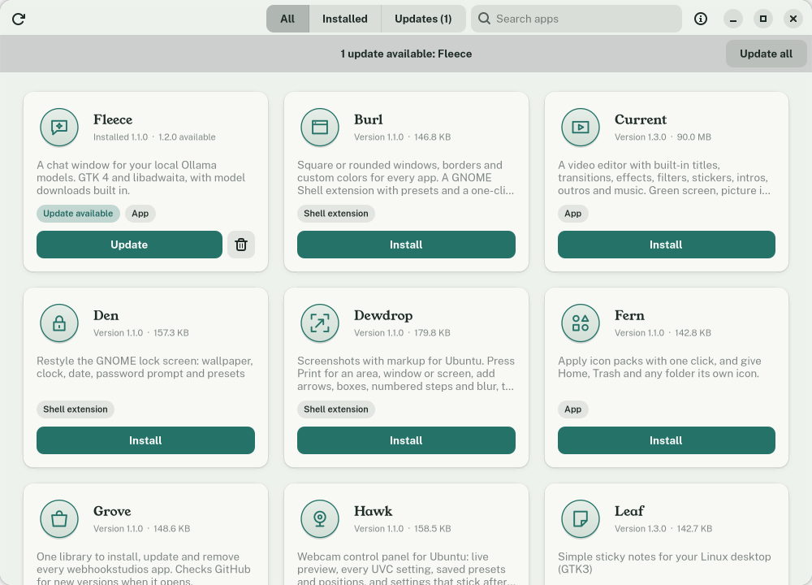
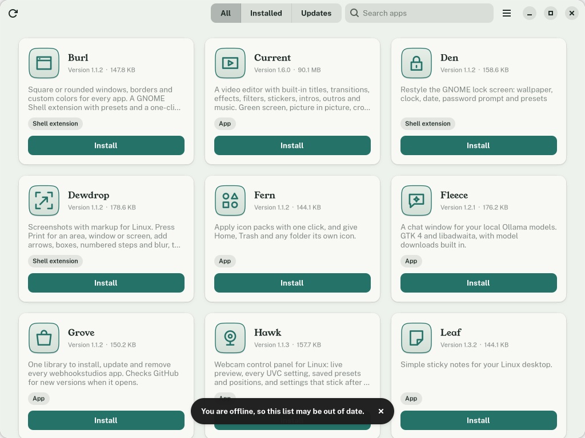

# Grove

*Part of the Sedge family of webhookstudios apps.*

One library for every [webhookstudios](https://github.com/webhookstudios) app on Ubuntu. Browse them as cards, install, update or remove any of them with a click, and see new versions as soon as you open it.



## What it does

- **Sets up a new computer in one go.** The first time Grove opens, it lists every app with a checkbox. Leave them all ticked or pick the ones you want, press **Install selected**, and Grove installs them together with one password prompt.
- **Finds the apps by itself.** It reads webhookstudios' public repos on GitHub and lists every one whose latest release has a `.deb`. A new app shows up the day it is released, with no update to Grove.
- **Checks for updates every time it opens**, and shows a banner with an **Update all** button.
- **Installs, updates and removes** through apt, so dependencies are handled and everything appears in the normal package list. You are asked for your password once, by the standard system prompt.
- **Shows each app's details:** description, versions, size, release notes and its screenshots.
- **Works offline** with the last list it saw, and tells you it may be out of date.
- Downloads are checked against the checksum GitHub publishes before anything is installed.

## Requirements

- Ubuntu 26.04 (any recent Debian-based system with GTK 4 and libadwaita 1.5 or later should work)
- An internet connection to see new apps and versions

## Install

### With the deb package (recommended)

Download `grove_1.2.0_all.deb` from the [latest release](https://github.com/webhookstudios/grove/releases/latest), then install it:

```bash
sudo apt install ./grove_1.2.0_all.deb
```

Open **Grove** from the apps menu. After that, Grove can update itself like any other app in the list.

To remove it:

```bash
sudo apt remove grove
```

### From source

```bash
git clone https://github.com/webhookstudios/grove.git
```

```bash
./grove/install.sh
```

## Using it

| To do this | Do this |
|---|---|
| Install several apps at once | Open the menu at the top right, choose **Set up apps**, tick the ones you want, then click **Install selected** |
| Install an app | Click **Install** on its card |
| Update one app | Click **Update** on its card |
| Update everything | Click **Update all** in the banner |
| Open an app | Click **Open** (for a shell extension it opens its settings) |
| Remove an app | Click the trash icon, then confirm |
| See details and screenshots | Click an app's icon or name |
| Check again | Click the refresh button at the top left |

The **Installed** and **Updates** tabs filter the list, and the search box matches names and descriptions.

Shell extensions, such as Sprig and Sheaf, only turn on after you log out and back in. Grove sets new ones to turn on, and after a setup it offers one **Log out** for all of them.

### Setting up several apps



- **Already installed** apps are listed at the bottom and left alone. Apps with an update are ticked and updated.
- **Things the apps need**, such as Python and GTK, come from your system's software sources through apt, in the same install.
- **Fleece needs Ollama** to run its AI models. Ollama is not in Ubuntu's software sources, so when Fleece is ticked and Ollama is missing, the list adds an **Ollama** row. It is installed with the official installer from ollama.com, in the same password prompt.
- **Apps made for other computers**, such as Current on a 64-bit ARM computer, are shown as not available instead of failing.

## How it works

Grove asks the GitHub API for the owner's repos and each one's latest release. Answers are cached in `~/.cache/grove` with their ETag, so an unchanged answer costs nothing against GitHub's limit of 60 requests an hour for anonymous use. Installed versions come from `dpkg-query`. Installing downloads the `.deb` files to a temporary folder and runs `apt-get install` through `pkexec`; removing runs `apt-get remove`. When Ollama is ticked, the same `pkexec` run also installs `curl` and `zstd` and then runs Ollama's installer. New shell extensions are added to GNOME's `enabled-extensions` list, so they start at the next login.

| File | Purpose |
|---|---|
| `grove/github.py` | Finds apps and releases, downloads and checks files |
| `grove/packages.py` | Installed versions, install and remove through polkit |
| `grove/window.py` | The main window, filters, install and update flows |
| `grove/card.py`, `grove/details.py` | The app cards and the details window |
| `grove/setup.py` | The setup checklist for installing several apps at once |
| `grove/ollama.py` | Installing Ollama for Fleece with its official installer |
| `grove/state.py` | Remembers that the checklist was shown, in `~/.config/grove` |

## Limitations

- Only apps with a `.deb` in their latest GitHub release are listed.
- GitHub allows 60 anonymous requests an hour. Opening Grove uses about ten, and unchanged answers are free, so this is only a problem if you reopen it dozens of times in an hour.
- Removing an app keeps its settings, the way `apt remove` does.
- Ollama's installer comes straight from ollama.com. Unlike the apps, it has no published checksum for Grove to check.

## Development

```bash
python3 bin/grove
```

Build the deb package into `dist/` with `./build-deb.sh` (needs only `dpkg-deb`).

## License

GPL-2.0-or-later. See [LICENSE](LICENSE).
